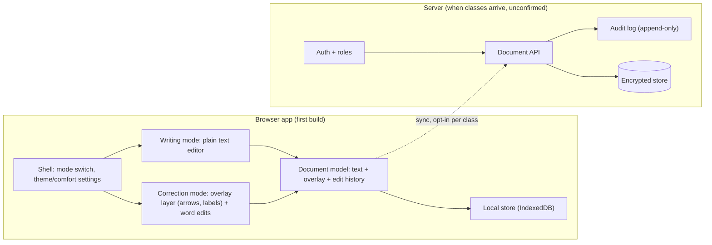
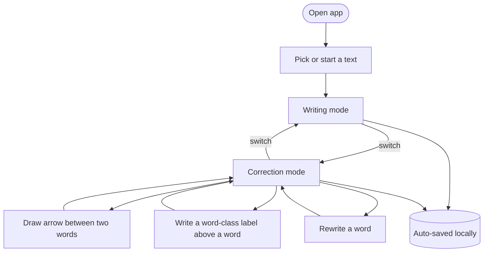
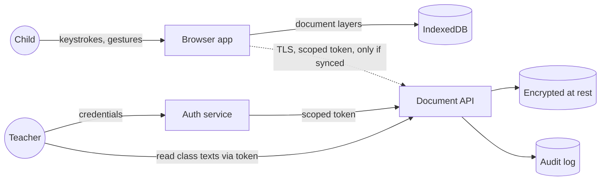
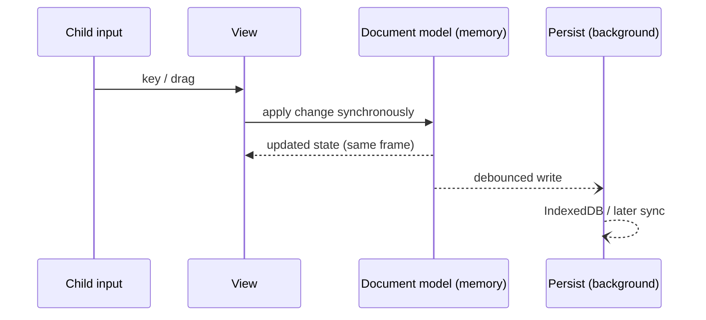

# Flechettes architecture

Priorities, in order: **1 Security, 2 Speed, 3 Cosmetics** (child-friendly UI, ages 5–14). When they conflict, the higher one wins, and the exception is recorded under Decisions. Choices marked *(unconfirmed)* are inferred and await review.

## 1. Block-functionality diagram

What the system is made of and who owns what. The first build is only the browser block; the server blocks exist in the design so that the first build does not have to be redone when classes arrive.

**Owned boundaries**
- *Document model* is the single source of truth for a text: three separate layers (original text, overlay, corrections) so a teacher can read the child's process.
- *Writing mode* and *correction mode* are views over the document model. Neither contains any linguistic logic.
- *Linguistic neutrality:* no component holds a dictionary, tokenizer-for-grammar, or word-type data. Words are split only by whitespace/punctuation to give overlay anchors.

## 2. User-flow diagram

Rules: switching is one tap and never loses state; no step shows a verdict on the text; saving is silent and automatic.

## 3. Data-flow diagram (trust boundaries)

Trust boundaries: browser ↔ network, network ↔ server, server ↔ storage. First build crosses none: **no network traffic carries text**.

## 4. Edit-action sequence (speed path)

The interface only ever waits on in-memory state; persistence and any network are off the interaction path.

## Decisions

| Priority | Decision | Reason / exception |
|---|---|---|
| Security | **Local-first, no accounts in the first build** (from the goal doc): no child data leaves the device. | Smallest attack surface; nothing to leak server-side. |
| Security | Server design, when added: role-based access (child → own texts; teacher → own classes only), deny by default, per-class scoping. *(unconfirmed)* | Child data is critical; least privilege. |
| Security | Encryption in transit (TLS) and at rest; append-only audit log of every read/write of a child's document by someone other than the child. *(unconfirmed)* | Confidentiality and auditability. |
| Security | No third-party scripts, analytics, fonts or CDNs; strict Content-Security-Policy. | Prevents leaking child content or behavior to third parties. |
| Security | Local texts are readable by anyone with access to the device/browser profile. **Accepted limitation** of local-first in the first build. | Shared school computers are a risk; to revisit with accounts. |
| Speed | All interactions apply to in-memory state synchronously; persistence is debounced and background. | No UI waits on disk or network. |
| Speed | Static SPA bundle, kept small; no server round-trip to open or edit a text. | Impatient users; offline works. |
| Speed | Exception: sync (future) is asynchronous and shows no blocking spinner; a failure never blocks writing. | Data safety does not trade off against responsiveness. |
| Cosmetics | One UI with a **simple default** and an optional "more control" tier (finer colors, line styles, layout) revealed by choice. *(unconfirmed)* | Ages 5–14; never overwhelming. |
| Cosmetics | Customization is limited to appearance (theme, font size, spacing, mascot/colors), stored in the local profile. | Personalization without distraction; none affects text content. |
| Stack | TypeScript SPA; the overlay is an SVG layer positioned over the text, not inside it. | Text stays plain; arrows track word positions as it reflows (built, see `overlay`). |

## Modules

| Module | Owns | Depends on |
|---|---|---|
| `model` | words, corrections, overlay anchors, undo history; no browser APIs | none |
| `overlay` | arrows and word labels: data, validation, pure layout | `model` |
| `storage` | IndexedDB library, bin, backup import/export | `model`, `overlay` (to validate arrows on import) |
| `editor-ui` | list screen, left tool rail, the paged sheet, writing and correction surfaces, arrow and tag layers, label picker, settings | `model`, `overlay`, `storage` |

## Built so far

- The production build ships a strict Content-Security-Policy (`connect-src 'none'`, same-origin scripts, styles and fonts only; the font is bundled), so the page cannot send child text anywhere even if a bug let it try.
- Arrows and labels are stored by word id with enumerated values (side, color, class, gender, number); import rejects anything else.
- All layers drawn over the sheet share one layout measurement per animation frame, and nothing is measured when a text has no annotations.
- The sheet is sized in container-width units so wrapping, page breaks and annotation positions are identical at every screen size; type size is a property of the text, not the device. The title is the first line of the text (words like any other), not a separate field; the interface shows it in its own region at the top of the sheet.
- Pages are columns of one text flow, clipped by the sheet and slid sideways to turn; a plain-text editable flow was verified to behave in columns in Chromium (caret, typing, selection, undo).
- Corrected words are atomic in writing mode and every correction records original, replacements and times, so a teacher can later read the child's process.

## Not decided here

The correction overlay (arrows, labels), sync protocol, and server hosting are settled when the feature that needs them is built, through module specs.
