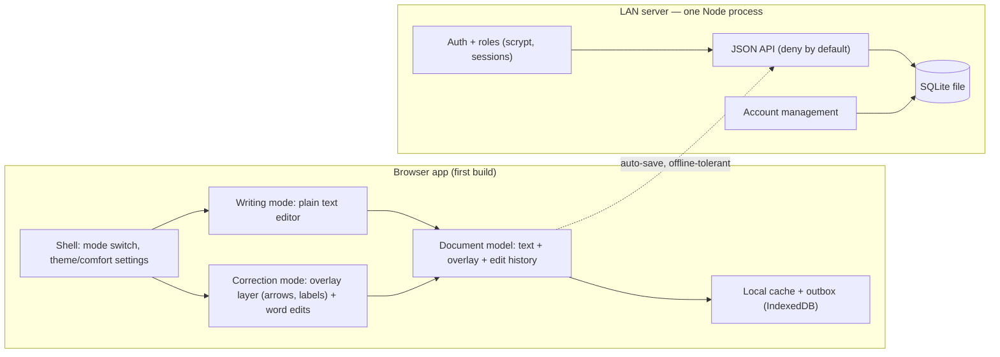
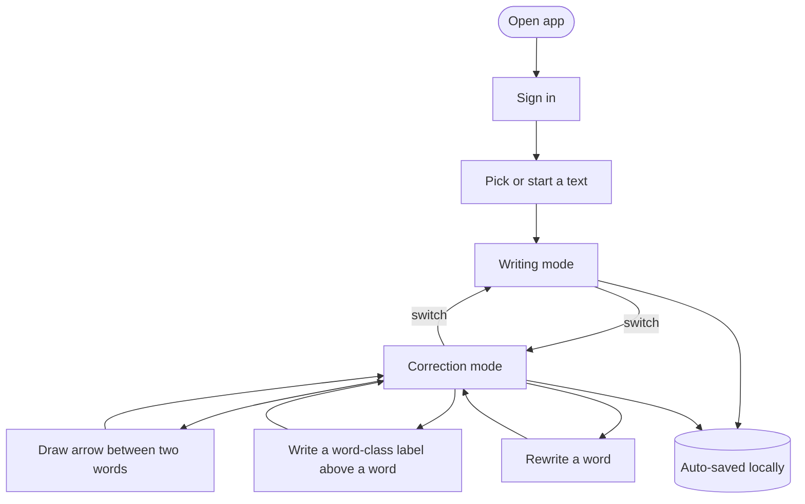
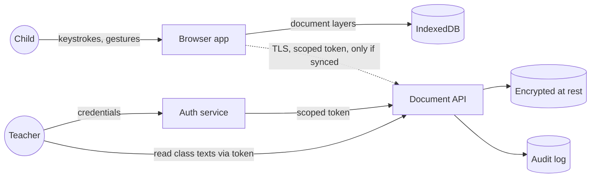
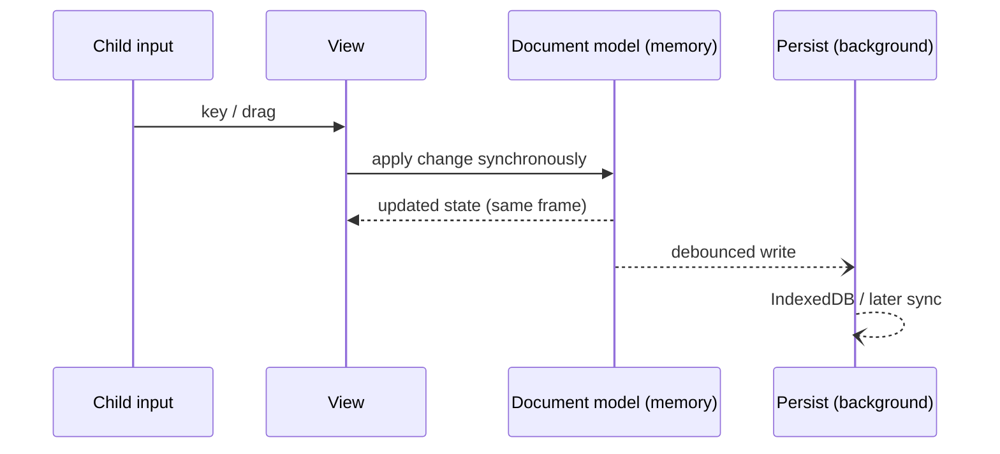

# Flechettes architecture

Priorities, in order: **1 Security, 2 Speed, 3 Cosmetics** (child-friendly UI, ages 5–14). When they conflict, the higher one wins, and the exception is recorded under Decisions. Choices marked *(unconfirmed)* are inferred and await review.

## 1. Block-functionality diagram

What the system is made of and who owns what. Both blocks now exist: a self-contained LAN server owns storage and identity, and the browser app is a fast, offline-tolerant client over it.

**Owned boundaries**
- *Document model* is the single source of truth for a text: three separate layers (original text, overlay, corrections) so a teacher can read the child's process.
- *Writing mode* and *correction mode* are views over the document model. Neither contains any linguistic logic.
- *Linguistic neutrality:* no component holds a dictionary, tokenizer-for-grammar, or word-type data. Words are split only by whitespace/punctuation to give overlay anchors.
- *Source of truth:* the **server** owns persistence and identity; the browser's **document model** owns the live editing of an open text. The server re-validates every document with the client's own import rules (untrusted input).

## 2. User-flow diagram

Rules: switching is one tap and never loses state; no step shows a verdict on the text; saving is silent and automatic.

## 3. Data-flow diagram (trust boundaries)

Trust boundaries: browser ↔ network, network ↔ server, server ↔ storage. Text now crosses browser↔server: on a trusted LAN this is **plain HTTP** (see Decisions) — the network is trusted, not encrypted.

## 4. Edit-action sequence (speed path)

The interface only ever waits on in-memory state; persistence and any network are off the interaction path.

## Decisions

| Priority | Decision | Reason / exception |
|---|---|---|
| Security | **The server is the source of truth**, reached over the LAN; everyone signs in. The browser keeps a local cache + outbox so writing never waits on the network, and the cache is cleared on logout. | Work roams across computers (and is collectable later) without losing instant, offline-tolerant writing. |
| Security | **Role-based access**: student → own texts; teacher → manage own students/classes; admin → manage teachers. Deny by default, ownership-checked on every route; a disabled account's sessions are dropped at once. | Child data is critical; least privilege. |
| Security | **Transport is plain HTTP on the trusted LAN** (no public CA). Passwords are stored hashed (scrypt); the SQLite file is not encrypted at rest. | Self-sufficient on a LAN without certificate infrastructure. **Accepted limitation:** passwords and texts cross the LAN unencrypted; revisit with TLS or a reverse proxy. |
| Security | No third-party scripts, analytics, fonts, CDNs **or external APIs**; strict Content-Security-Policy (`connect-src 'self'` — the SPA reaches only its own origin). | Prevents leaking child content or behavior to third parties; keeps the server self-contained. |
| Security | On a shared computer, accounts + cache-clear-on-logout mean one student no longer sees another's work once it has synced. | Addresses the old local-first exposure. **Residual limitation:** if the server is unreachable at logout, unsynced work stays cached until it syncs (never lost). |
| Security | An append-only audit log of cross-user document access is **deferred** with teacher text-reading (no cross-user reads this milestone). | Nothing to audit until teachers can read student texts. |
| Speed | All interactions apply to in-memory state synchronously; persistence is debounced and background. | No UI waits on disk or network. |
| Speed | Static SPA bundle, kept small; opening and editing apply to in-memory/cached state first, and the server save is background. | Impatient users; offline works. |
| Speed | Saving to the server is asynchronous and shows no blocking spinner; a brief outage queues locally and retries, and a failure never blocks writing. | Data safety does not trade off against responsiveness. |
| Cosmetics | One UI with a **simple default** and an optional "more control" tier (finer colors, line styles, layout) revealed by choice. *(unconfirmed)* | Ages 5–14; never overwhelming. |
| Cosmetics | Customization is limited to appearance (theme, font size, spacing, mascot/colors), stored in the local profile. | Personalization without distraction; none affects text content. |
| Stack | TypeScript SPA; the overlay is an SVG layer positioned over the text, not inside it. | Text stays plain; arrows track word positions as it reflows (built, see `overlay`). |
| Stack | Self-contained **Node + TypeScript** server (one process serves the SPA + JSON API) over **SQLite** (one file); launched with one command. | Reuses the client's model/overlay/import validation server-side; no external service to install, back up (copy the file) or depend on. |

## Modules

| Module | Owns | Depends on |
|---|---|---|
| `model` | words, corrections, overlay anchors, undo history; no browser APIs | none |
| `overlay` | arrows and word labels: data, validation, pure layout | `model` |
| `storage` | the `Store` interface, server-backed store, offline cache + outbox (clear-on-logout), bin, one-time local-import; import/export validation | `model`, `overlay` (to validate arrows on import) |
| `server` | LAN deployment: serves the SPA + JSON API, SQLite data layer, auth (scrypt + sessions, idle timeout), role/ownership enforcement, texts API, account management | `model`, `overlay`, `storage` (shares validation) |
| `editor-ui` | list screen, left tool rail, the paged sheet, writing and correction surfaces, arrow and tag layers, label picker, settings; sign-in / first-run / logout, account bar, account-management screens, saving indicator | `model`, `overlay`, `storage` |

## Built so far

- The production build ships a strict Content-Security-Policy (`connect-src 'self'`, same-origin scripts, styles and fonts only; the font is bundled), so the page can reach only its own origin's API and nothing third-party.
- The server runs as one Node process serving the built SPA and a JSON API backed by one SQLite file; auth is server-side sessions + an httpOnly cookie, passwords hashed with built-in scrypt, with an idle timeout and a CSRF app-header check. See `server`.
- Texts reach the server through the same `Store` interface the local app used, wrapped by an offline cache + outbox, so the editor code is unchanged and writing never waits on the network. See `storage`.
- The server re-runs the client's import validation on every stored document, so a buggy or hostile client cannot write malformed data.
- Arrows and labels are stored by word id with enumerated values (side, color, class, gender, number); import rejects anything else.
- All layers drawn over the sheet share one layout measurement per animation frame, and nothing is measured when a text has no annotations.
- The sheet is sized in container-width units so wrapping, page breaks and annotation positions are identical at every screen size; type size is a property of the text, not the device. The title is the first line of the text (words like any other), not a separate field; the interface shows it in its own region at the top of the sheet.
- Pages are columns of one text flow, clipped by the sheet and slid sideways to turn; a plain-text editable flow was verified to behave in columns in Chromium (caret, typing, selection, undo).
- Corrected words are atomic in writing mode and every correction records original, replacements and times, so a teacher can later read the child's process.

## Not decided here

Teacher viewing/collecting of student texts, richer class features, an append-only audit log, a whole-server admin backup, and TLS/reverse-proxy transport are deferred; each is settled in its module spec when built.
